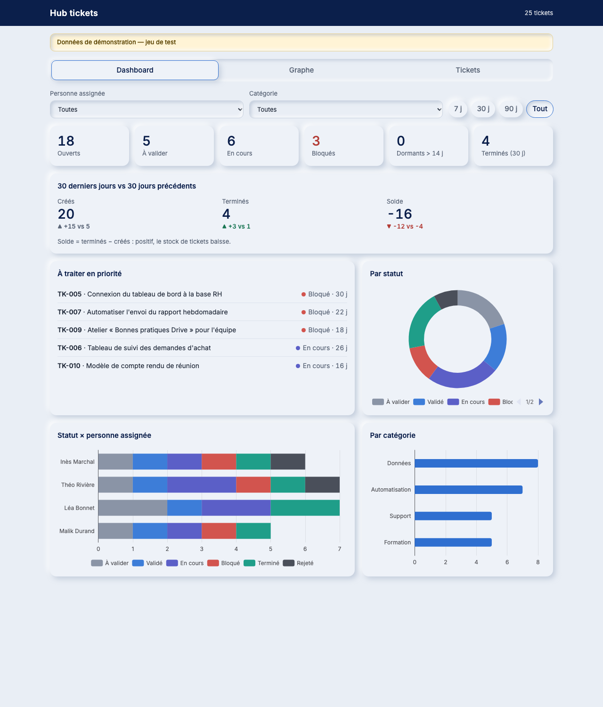
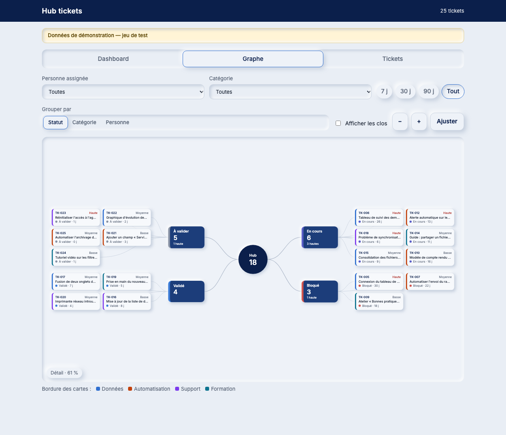
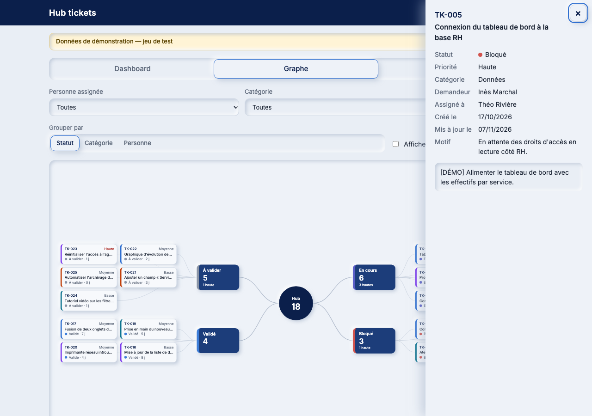
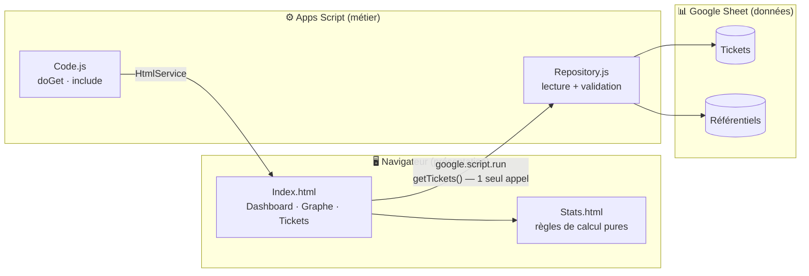
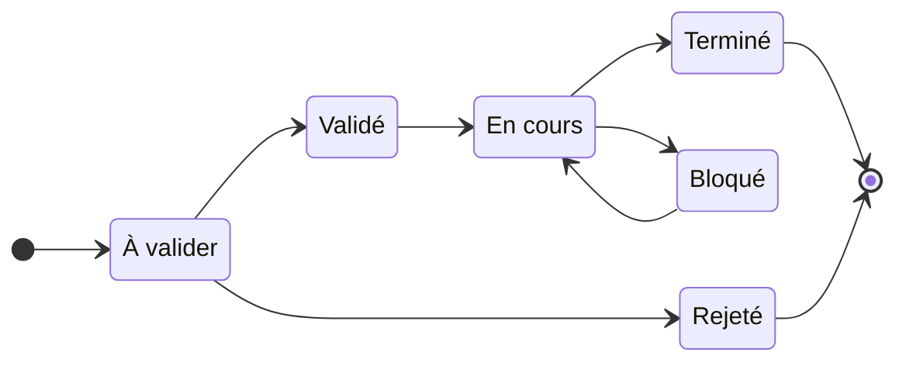

<div align="center">

# 🛰️ Hub tickets

**Un tableau de bord de suivi de tickets qui tourne entièrement dans Google Workspace.**
Un Google Sheet comme base de données, une web app Apps Script comme interface, un Google Site pour la diffuser.




</div>

> [!NOTE]
> Projet en cours de construction, actuellement en **phase de démonstration** : le Sheet contient un jeu de 25 tickets fictifs (préfixe `[DÉMO]`) et l'interface l'indique par un bandeau. Ce README sera complété à la fin du projet.

---

## Sommaire

- [Le projet en bref](#-le-projet-en-bref)
- [À quoi ça ressemble](#-à-quoi-ça-ressemble)
- [Architecture](#-architecture)
- [Mise en place avec clasp](#-mise-en-place-avec-clasp)
- [Utilisation](#-utilisation)
- [Développement](#-développement)
- [Feuille de route](#-feuille-de-route)

---

## 🎯 Le projet en bref

**Le besoin :** suivre des tickets (demandes, incidents, tâches) pour une équipe qui n'a accès **qu'à Google Workspace** — pas de serveur, pas de base de données, pas d'outil SaaS à faire valider.

**La réponse :**

| Brique | Rôle |
|---|---|
| 📊 **Google Sheet** | Source de vérité unique : une ligne = un ticket. On peut saisir depuis l'application *ou* coller des lignes à la main. |
| ⚙️ **Apps Script** (développé en local avec `clasp`) | Lit et valide les données, sert l'interface web. |
| 🖥️ **Web app** (HtmlService) | Trois vues : **Dashboard**, **Graphe**, **Tickets**. Un seul appel serveur au chargement, tout le reste est calculé dans le navigateur. |
| 🌐 **Google Sites** | Page d'accès pour les utilisateurs (la web app y est intégrée). |

**Principes qui guident le code :**
- **Zéro dépendance réseau** — l'application doit marcher sur un réseau d'entreprise qui filtre les CDN : JavaScript vanilla, ECharts **embarqué** dans le projet, police avec repli système.
- **Le plus simple qui marche** (YAGNI), et **les règles métier testées** (KPI, fenêtres de dates, regroupements).
- **Tolérant aux saisies manuelles** — une ligne incomplète collée dans le Sheet est *signalée*, jamais bloquante.
- **Lisible et accessible** — charte sobre bleu marine, néomorphisme doux mais contraste AA, utilisable au clavier et à 375 px de large.

---

## 👀 À quoi ça ressemble

### Dashboard — l'état des tickets en un coup d'œil
6 indicateurs, comparaison des **30 derniers jours** avec les 30 précédents, la liste **« À traiter en priorité »** (bloqués d'abord, puis les plus anciens) et trois graphiques. Les filtres (personne, catégorie, période) s'appliquent à tout.


### Graphe — la répartition du travail en cours
Un arbre **Hub → branches → cartes**, sur deux côtés. On groupe par **statut**, **catégorie** ou **personne** ; on zoome et on se déplace à la souris ou au doigt.



Dézoomé sous 60 %, l'arbre passe en **vue d'ensemble** : il ne reste que le Hub et les branches avec leurs compteurs. Un clic sur un ticket ouvre sa **fiche** dans un panneau latéral :



> Les captures sont générées à partir du jeu de démonstration.

---

## 🏗️ Architecture

Une architecture **3-tiers** dont chaque couche est un service Google :



```text
.
├─ src/                     ← poussé vers Apps Script par clasp (rootDir)
│  ├─ appsscript.json       fuseau Europe/Paris, runtime V8, web app
│  ├─ Code.js               doGet() et include() — points d'entrée
│  ├─ Repository.js         lecture du Sheet → objets JSON (dates ISO, anomalies)
│  ├─ Setup.js              création des feuilles, référentiels, validations, jeu de démo
│  ├─ Index.html            squelette de la page (inclut les fichiers ci-dessous)
│  ├─ Styles.html           charte : jetons CSS, relief / creusé, composants
│  ├─ Vendor.html           ECharts 6.1.0 embarqué (généré, ne pas modifier)
│  ├─ Stats.html            calculs purs : KPI, filtres, regroupements (testés)
│  ├─ Charts.html           options des graphiques ECharts
│  ├─ Fiche.html            panneau de détail d'un ticket
│  ├─ Graphe.html           arbre, zoom, vue d'ensemble
│  └─ App.html              état, chargement, navigation, rendu
├─ tests/                   tests Node (jamais poussés vers Google)
├─ scripts/vendor.js        génère src/Vendor.html depuis node_modules
└─ docs/superpowers/        conceptions, plans et maquettes de chaque étape
```

**Pourquoi un script *lié* au Sheet ?** `SpreadsheetApp.getActive()` fonctionne sans ID en dur, et le Sheet reste l'unique source de vérité.
**Pourquoi tout calculer côté navigateur ?** Un seul aller-retour réseau au chargement ; chaque filtre s'applique instantanément.

---

## 🚀 Mise en place avec clasp

### Prérequis
- **Node.js** (≥ 18) et **npm**
- Un **compte Google** (Workspace ou Gmail)
- L'**API Google Apps Script activée** : <https://script.google.com/home/usersettings> → *API Google Apps Script* : **Activé**

### 1. Installer les outils

```bash
npm install -g @google/clasp
```

```bash
npm install
```

### 2. Se connecter à Google

```bash
clasp login
```

Le navigateur s'ouvre pour l'autorisation ; le jeton est enregistré dans `~/.clasprc.json` (hors du dépôt — ne jamais le partager).

### 3. Créer le Sheet et son script

```bash
clasp create-script --type sheets --title "Hub tickets" --rootDir src
```

Cette commande crée un Google Sheet **avec son script attaché** et écrit `.clasp.json` (ignoré par Git : il pointe vers *votre* projet).

> [!TIP]
> Le projet existe déjà sur votre Drive ? Récupérez son ID de script (Apps Script → *Paramètres du projet*) et utilisez `clasp clone-script <ID> --rootDir src` à la place.

### 4. Envoyer le code

```bash
clasp push
```

> Si clasp signale que le manifeste a changé, confirmez : `src/appsscript.json` fixe le fuseau horaire (Europe/Paris) et la configuration de la web app.

### 5. Initialiser le Sheet

Ouvrez l'éditeur (`npm run open`), puis exécutez dans l'ordre :

1. **`setupSheets`** — crée les feuilles *Tickets* et *Référentiels*, les listes déroulantes et les signalements visuels (la première exécution demande votre autorisation).
2. **`seedDemoData`** — insère les 25 tickets de démonstration.

Rechargez le Sheet : un menu **Hub tickets** apparaît.

### 6. Tester la web app

Éditeur Apps Script → **Déployer → Tester les déploiements** → ouvrir l'URL qui se termine par **`/dev`**.

> [!IMPORTANT]
> Le déploiement versionné (URL `/exec`) et l'intégration dans Google Sites sont l'objet de la dernière étape du projet : cette section sera complétée à ce moment-là.

---

## 🧭 Utilisation

### Dans le Google Sheet

**Feuille `Tickets`** — une ligne par ticket :

| Colonne | Contenu | Règle |
|---|---|---|
| ID | `TK-001`… | généré par l'application ; s'il manque, la cellule est **surlignée en rouge** |
| Créé le / Mis à jour le | date et heure | format `jj/mm/aaaa hh:mm` |
| Titre, Description | texte | — |
| Catégorie, Priorité, Demandeur, Assigné à, Statut | listes déroulantes | valeurs de la feuille *Référentiels* |
| Motif | texte | **obligatoire** si le statut est *Bloqué* ou *Rejeté* (sinon surligné en rouge) |

**Feuille `Référentiels`** — les listes autorisées. Ajouter une personne ou une catégorie ici l'ajoute automatiquement aux listes déroulantes et aux filtres de l'application.

**Menu `Hub tickets`** :
- *Initialiser les feuilles* — remet en forme sans toucher aux données (relançable sans risque).
- *Réinitialiser la démo…* — recrée les 25 tickets de démonstration. **Refuse de s'exécuter** si la feuille contient des tickets qui ne sont pas des données de démo.

### Cycle de vie d'un ticket



### Dans l'application

**Dashboard**

| Indicateur | Définition |
|---|---|
| **Ouverts** | statut À valider, Validé, En cours ou Bloqué |
| **À valider** | en attente de décision — la file d'entrée |
| **En cours** / **Bloqués** | sous-ensembles des ouverts (Bloqués en rouge) |
| **Dormants > 14 j** | ouverts, sans mise à jour depuis au moins 15 jours pleins — à relancer |
| **Terminés (30 j)** | passés à Terminé dans les 30 derniers jours (approximé par « Mis à jour le ») |
| **Comparaison** | créés, terminés et **solde** (terminés − créés) sur 30 jours glissants vs les 30 précédents ; solde positif = le stock baisse |

Les filtres : **personne assignée**, **catégorie**, **période** de création (7 j / 30 j / 90 j / Tout).

**Graphe**
- *Grouper par* statut, catégorie ou personne ; *Afficher les clos* pour inclure Terminés et Rejetés.
- Molette ou pincement pour zoomer, glisser pour se déplacer, **Ajuster** pour tout revoir.
- Sous 60 % : vue d'ensemble (compteurs) ; clic sur une branche pour zoomer dessus.
- Clic — ou **Tab** puis **Entrée** — sur une carte : fiche détaillée ; **Échap** pour la fermer.

**Tickets** — liste, création et modification depuis le site : *à venir* (voir la feuille de route).

---

## 🛠️ Développement

| Commande | Effet |
|---|---|
| `npm test` | lance les tests Node (règles de calcul, lecture du Sheet, garde-fous) |
| `npm run push` | envoie `src/` vers Apps Script (`clasp push`) |
| `npm run open` | ouvre le projet dans l'éditeur Apps Script |
| `npm run vendor` | régénère `src/Vendor.html` depuis la version d'ECharts fixée dans `package.json` |

**Conventions**
- **Pas de modules** côté Apps Script : tout est global. Les fonctions suffixées par `_` sont privées (ni exécutables depuis l'éditeur, ni appelables par le navigateur).
- Les fichiers HTML sont assemblés par `<?!= include('Nom') ?>` dans `Index.html` ; **l'ordre d'inclusion compte**.
- La logique métier va dans des **fonctions pures** (`Repository.js`, `Stats.html`), testées en chargeant le code dans un bac à sable `node:vm`.
- Tout texte venant du Sheet est **échappé** avant d'être inséré en HTML (`echapper()` ou `textContent`).

**Méthode** — chaque étape suit le même cycle : conception validée → plan → implémentation en TDD → revue indépendante → test `/dev`. Les documents sont dans [`docs/superpowers/`](docs/superpowers/).

---

## 🗺️ Feuille de route

- [x] **0** — Initialisation clasp, manifeste, dépôt
- [x] **1** — `Setup.js` : feuilles, référentiels, validations, jeu de démo
- [x] **2** — `Repository.js` + `getTickets()` : lecture tolérante aux saisies manuelles
- [x] **3** — Squelette, charte graphique, navigation, gestion d'erreur
- [x] **4** — Dashboard : KPI, comparaison 30 j, liste à traiter, graphiques, filtres
- [x] **5** — Graphe : arbre à deux côtés, zoom, vue d'ensemble, fiche latérale *(en cours de validation)*
- [ ] **6** — Tickets : liste, création, changement de statut, suppression (verrou `LockService`, validation serveur)
- [ ] **7** — Déploiement versionné et intégration dans Google Sites

---

<div align="center">
<sub>Projet réalisé dans le cadre d'un Master MIAGE en alternance · données de démonstration entièrement fictives</sub>
</div>
